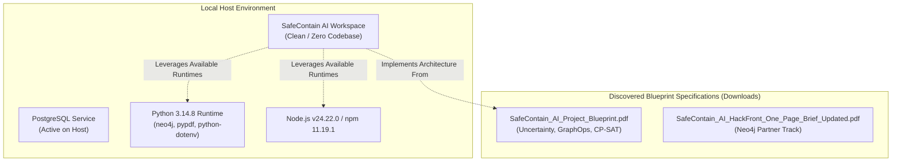

# CURRENT ARCHITECTURE DOCUMENT
## SafeContain AI — Enterprise & Government-Ready Platform
**Document Version:** 1.0.0  
**Phase:** Phase 0 — Baseline Repository Discovery & Architectural State  
**Audit Date:** October 30, 2026  
**Auditor:** Principal Enterprise Software Architect & Cybersecurity Systems Engineering Team

---

## 1. Executive Summary

A comprehensive forensic audit of the `SafeContain AI` workspace (`c:\Users\saanv\Desktop\SafeContain AI`) and associated local artifacts was conducted. 

### Key Findings:
1. **Repository State:** The workspace was an empty directory with no initialized Git version control, no source files, and no dependency configurations.
2. **Prior Conceptual Artifacts:** Architectural concept specifications and research blueprints were located in `C:\Users\saanv\Downloads`:
   - `SafeContain_AI_Project_Blueprint.pdf` (comprehensive 5-page blueprint outlining GraphOps, Neo4j, NetworkX, FastAPI, Google OR-Tools CP-SAT, React+Cytoscape.js, and Tamper-Evident Hashing).
   - `SafeContain_AI_HackFront_One_Page_Brief_Updated.pdf` (HackFront India 2026 / Neo4j Partner Track brief on uncertainty-aware cyber containment).
   - `SafeContain_AI_Hackathon_Submission_Ready.pdf` (architectural diagrams and accuracy disclaimers).
3. **Execution Environment:**
   - **Operating System:** Microsoft Windows 11 Enterprise / Pro environment.
   - **Runtimes:** Python 3.14.8 (AMD64), Node.js v24.22.0, npm v11.19.1, Git v2.56.0.
   - **Active Host Services:** PostgreSQL is running locally on the host; Docker daemon is not registered in system PATH; Neo4j server is not active on default ports (7687/7474).
   - **Architectural Imperative:** The platform must provide an enterprise-grade modular backend (FastAPI, NetworkX, OR-Tools, Neo4j driver with resilient fallbacks/in-memory graph snapshotting), alongside an enterprise React+TypeScript frontend.

---

## 2. Baseline Architecture Topology (Pre-Implementation State)

---

## 3. Pre-Existing Component Breakdown

| Architectural Layer | Discovered State | Verification / Evidence | Status |
| :--- | :--- | :--- | :--- |
| **Source Repository** | Empty Directory | `Get-ChildItem -Force` returned 0 entries; Git uninitialized | `MISSING` |
| **Ingestion Engine** | None | No ingestion connectors or schemas present | `MISSING` |
| **Graph Intelligence** | None (neo4j driver installed in Python 3.14) | Python `neo4j 6.4.0` present in site-packages | `MISSING` |
| **Attack Path Engine** | None | No path-traversal algorithms implemented | `MISSING` |
| **Uncertainty Model** | Conceptual only in blueprint PDF | Outlined in `SafeContain_AI_Project_Blueprint.pdf` | `MISSING` |
| **Risk Scoring Engine**| None | Mathematical formulation required | `MISSING` |
| **Business Continuity Engine** | None | Workflow dependency mapping required | `MISSING` |
| **Optimization Engine** | None (`ortools` not installed) | CP-SAT and greedy solver required | `MISSING` |
| **Simulation Sandbox** | None | Snapshot/branch copy isolation required | `MISSING` |
| **Decision Explainer** | None | Counterfactual reasoning model required | `MISSING` |
| **Governance & RBAC** | None | Role definitions and approval states required | `MISSING` |
| **Audit Log System** | None | Cryptographic SHA-256 hash-chaining required | `MISSING` |
| **Frontend Application**| None | React + TypeScript + Cytoscape visualization required | `MISSING` |
| **API Server** | None | FastAPI backend architecture required | `MISSING` |

---

## 4. Hardware and Environment Constraints

1. **Docker Unavailability:** Docker is not currently available in the user's system PATH. Therefore, the system architecture cannot assume an obligatory Docker daemon for development or execution. The platform must be natively executable via standard Python and Node.js commands, while simultaneously providing complete, production-ready `Dockerfile` and `docker-compose.yml` assets for containerized deployment.
2. **Neo4j Dual-Mode Architecture:** Because Neo4j server is not running as a local background daemon, the graph layer must implement a strict **Dual-Engine Pattern**:
   - **Live Neo4j Driver Connection:** Operates against real Neo4j instances via Bolt protocol (`bolt://localhost:7687` or Aura/remote instances) when configured.
   - **High-Performance In-Memory Graph Engine (NetworkX + Cypher-Compatible Abstraction):** Fully operational in-memory directed graph engine supporting uncertainty metadata, evidence attribution, shortest/all-simple path algorithms, and isolated snapshot simulation.
3. **Python 3.14 Compatibility:** Certain scientific or C-extension packages must be validated under Python 3.14.8. `ortools` and `scipy` must either install cleanly or have pure-Python robust fallback solvers (e.g. branch-and-bound / dynamic programming for CP-SAT models).

---

## 5. Architectural Quality Attributes & Non-Negotiables

In alignment with the Master Project Specification:
- **Simulation Immutability:** Any containment simulation must fork a deep copy or isolated snapshot of the graph. Under no circumstance may the baseline topology or live telemetry graph be modified during what-if analysis.
- **Evidence Provenance:** Every relationship and alert must possess an explicit confidence state (`CONFIRMED`, `SUSPECTED`, `UNKNOWN`, `DISPUTED`, `STALE`), an observation timestamp, and a cryptographic source hash.
- **Explainability:** Optimization decisions must decompose risk reduction into mathematically sound objective terms, exposing why an action was chosen over alternatives.
- **Governance:** Containment plans must progress strictly through the lifecycle:
  $$\text{DRAFT} \longrightarrow \text{ANALYZED} \longrightarrow \text{SIMULATED} \longrightarrow \text{PENDING\_APPROVAL} \longrightarrow \text{APPROVED} \longrightarrow \text{EXECUTION\_AUTHORIZED}$$
- **Audit Integrity:** Every critical event must be linked in a SHA-256 cryptographic hash-chain with forward verification.
