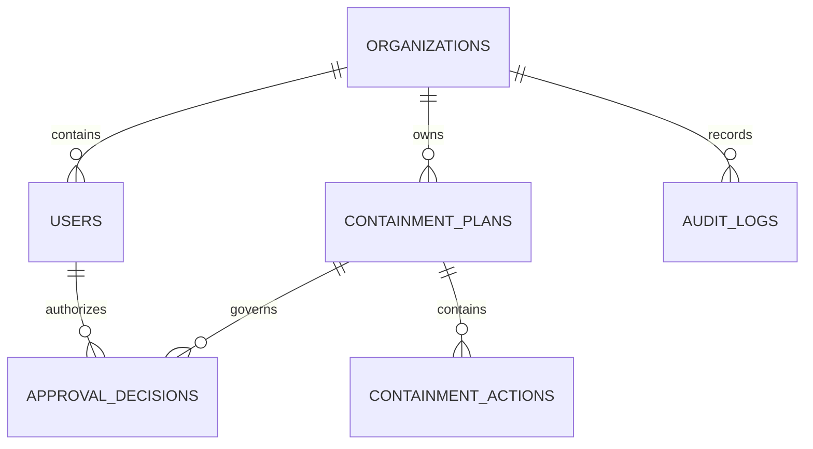

# RELATIONAL DATABASE SCHEMA SPECIFICATION
## SafeContain AI — PostgreSQL Metadata Store
**Document Version:** 1.0.0  
**Target RDBMS:** PostgreSQL 16+ / SQLite3 (Embedded Fallback)  

---

## 1. Relational ER Topology



---

## 2. DDL Schema Definition

```sql
-- Organizations / Tenants
CREATE TABLE organizations (
    id VARCHAR(64) PRIMARY KEY,
    name VARCHAR(255) NOT NULL,
    compliance_tier VARCHAR(64) DEFAULT 'ENTERPRISE_CRITICAL',
    created_at TIMESTAMP WITH TIME ZONE DEFAULT CURRENT_TIMESTAMP
);

-- Users and RBAC
CREATE TABLE users (
    id VARCHAR(64) PRIMARY KEY,
    organization_id VARCHAR(64) REFERENCES organizations(id) ON DELETE CASCADE,
    username VARCHAR(128) UNIQUE NOT NULL,
    email VARCHAR(255) UNIQUE NOT NULL,
    role VARCHAR(64) NOT NULL CHECK (role IN (
        'PLATFORM_ADMIN', 'SECURITY_ADMIN', 'SOC_ANALYST',
        'INCIDENT_RESPONDER', 'SECURITY_MANAGER', 'AUDITOR', 'READ_ONLY_VIEWER'
    )),
    is_active BOOLEAN DEFAULT TRUE,
    created_at TIMESTAMP WITH TIME ZONE DEFAULT CURRENT_TIMESTAMP
);

-- Containment Plans
CREATE TABLE containment_plans (
    id VARCHAR(64) PRIMARY KEY,
    organization_id VARCHAR(64) REFERENCES organizations(id) ON DELETE CASCADE,
    strategy VARCHAR(64) NOT NULL,
    total_cost NUMERIC(12, 2) NOT NULL,
    total_disruption_score NUMERIC(8, 2) NOT NULL,
    predicted_risk_reduction NUMERIC(8, 2) NOT NULL,
    predicted_residual_risk NUMERIC(8, 2) NOT NULL,
    status VARCHAR(64) NOT NULL DEFAULT 'DRAFT',
    explanation TEXT,
    created_at TIMESTAMP WITH TIME ZONE DEFAULT CURRENT_TIMESTAMP
);

-- Containment Actions (Line Items)
CREATE TABLE containment_actions (
    id VARCHAR(64) PRIMARY KEY,
    plan_id VARCHAR(64) REFERENCES containment_plans(id) ON DELETE CASCADE,
    action_type VARCHAR(64) NOT NULL,
    target_node_id VARCHAR(128) NOT NULL,
    target_node_name VARCHAR(255) NOT NULL,
    estimated_risk_reduction NUMERIC(8, 2) NOT NULL,
    operational_disruption_score NUMERIC(8, 2) NOT NULL,
    implementation_cost NUMERIC(12, 2) NOT NULL,
    estimated_duration_minutes INT NOT NULL,
    reversibility BOOLEAN DEFAULT TRUE,
    required_role VARCHAR(64) NOT NULL,
    rationale TEXT
);

-- Approval Governance Ledger
CREATE TABLE approval_decisions (
    id VARCHAR(64) PRIMARY KEY,
    plan_id VARCHAR(64) REFERENCES containment_plans(id) ON DELETE CASCADE,
    actor_id VARCHAR(64) REFERENCES users(id),
    decision VARCHAR(64) NOT NULL,
    actor_role VARCHAR(64) NOT NULL,
    notes TEXT,
    rejection_reason TEXT,
    timestamp TIMESTAMP WITH TIME ZONE DEFAULT CURRENT_TIMESTAMP
);

-- Cryptographic Audit Ledger Persistence Mirror
CREATE TABLE audit_ledger_records (
    event_id VARCHAR(64) PRIMARY KEY,
    organization_id VARCHAR(64) NOT NULL,
    timestamp TIMESTAMP WITH TIME ZONE NOT NULL,
    actor_id VARCHAR(64) NOT NULL,
    actor_role VARCHAR(64) NOT NULL,
    action VARCHAR(128) NOT NULL,
    resource_type VARCHAR(64) NOT NULL,
    resource_id VARCHAR(128) NOT NULL,
    metadata JSONB NOT NULL DEFAULT '{}'::jsonb,
    previous_hash CHAR(64) NOT NULL,
    current_hash CHAR(64) NOT NULL UNIQUE
);

CREATE INDEX idx_audit_ledger_timestamp ON audit_ledger_records(timestamp);
CREATE INDEX idx_audit_ledger_actor ON audit_ledger_records(actor_id);
```
