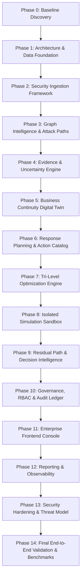

# IMPLEMENTATION ROADMAP & PHASE EXECUTION STRATEGY
## SafeContain AI — Enterprise Cybersecurity Platform
**Document Version:** 1.0.0  
**Phase:** Phase 0 Baseline  
**Date:** October 30, 2026  

---

## 1. Phased Execution Overview

SafeContain AI will be constructed following a disciplined, verification-driven, multi-phase engineering process. Each phase produces working, tested, production-grade capabilities with measurable verification before proceeding to the next.

---

## 2. Phase-by-Phase Execution Plan

### Phase 0: Repository Audit & Technical Baseline (COMPLETED)
- **Scope:** Forensic audit of workspace, environment runtime checks, discovery documents (`CURRENT_ARCHITECTURE.md`, `EXISTING_FEATURE_INVENTORY.md`, `REQUIREMENT_TRACEABILITY_MATRIX.md`, `TECHNICAL_DEBT_REGISTER.md`, `IMPLEMENTATION_ROADMAP.md`).
- **Deliverables:** Completed discovery reports; architectural baseline established.

### Phase 1: Architecture, Project Structure & Data Foundation
- **Scope:** Establish modern modular project layout (`backend/`, `frontend/`, `tests/`, `docs/`, `scripts/`). Setup Python virtual environment and dependencies (`fastapi`, `pydantic`, `uvicorn`, `networkx`, `pytest`, `httpx`). Implement core Pydantic domain models for entities, relationships, evidence, workflows, vulnerabilities, actions, and audit events.
- **Verification:** Unit tests validating domain schemas, immutability, serialization/deserialization, and type safety.

### Phase 2: Security Telemetry Ingestion Framework
- **Scope:** Build extensible ingestion pipeline with connectors for SIEM (Splunk/Elastic), EDR (CrowdStrike/Defender), IAM (Active Directory/Okta), Cloud Infrastructure (AWS/Azure), and Synthetic Scenarios. Schema validation, normalization, deduplication, timestamp recording, and provenance tagging.
- **Verification:** Ingestion test suite with valid, malformed, and duplicate payloads.

### Phase 3: Graph Intelligence & Directed Attack Path Engine
- **Scope:** Dual-mode graph engine (Neo4j Cypher connector + in-memory NetworkX graph engine). Graph schema constraints, indexing, node/edge creation. Multi-step directed attack path analysis: entry points, lateral movement, privilege escalation, crown jewel reachability, bottleneck/choke-point identification.
- **Verification:** Graph traversal tests on synthetic multi-subnet enterprise topologies.

### Phase 4: Uncertainty & Evidence Confidence Engine
- **Scope:** Five-state evidence model (`CONFIRMED`, `SUSPECTED`, `UNKNOWN`, `DISPUTED`, `STALE`). Confidence scoring algorithms, time-decay functions, and sensitivity analysis under evidence drift.
- **Verification:** Confidence calculation tests, uncertainty sensitivity matrix tests.

### Phase 5: Business Continuity Digital Twin
- **Scope:** Business workflow dependency graph (citizen portals, payment processing, healthcare EHR, internal directories). Mapping infrastructure assets to business operations. Calculation of service criticality, availability impact, downtime cost, and operational disruption.
- **Verification:** Business impact calculation tests with complex dependency chains.

### Phase 6: Response Action Catalog & Baseline Planning
- **Scope:** Formal catalog of 11+ cybersecurity containment actions (Endpoint Isolation, Credential Revocation, Network Microsegmentation, Firewall Policy, MFA Enforcement, Session Termination, DNS Sinkholing, Vulnerability Patching, Access Restriction, Honeypot Redirection, Enhanced Telemetry). Preconditions, execution costs, disruption metrics, and reversibility flags.
- **Verification:** Action validation tests and precondition enforcement checks.

### Phase 7: Tri-Level Optimization Engine
- **Scope:**
  - **Strategy 1 (Baseline):** Severity-first / highest-risk-first selection.
  - **Strategy 2 (Greedy):** Marginal risk reduction divided by operational disruption and financial cost.
  - **Strategy 3 (Constraint-Based / CP-SAT):** Mathematical constraint optimization (budget cap, critical workflow preservation, dependency ordering).
- **Verification:** Comparative solver tests verifying optimality, constraint satisfaction, and runtime.

### Phase 8: Isolated Simulation Sandbox
- **Scope:** Snapshot-based what-if simulation engine. Forks an immutable graph copy, applies candidate interventions to the copy only, and verifies zero mutation on the baseline infrastructure graph.
- **Verification:** Deep-cloning immutability tests proving baseline graph integrity is strictly preserved.

### Phase 9: Residual Path Intelligence & Explainable Decisions
- **Scope:** Mandatory post-containment graph re-traversal. Verification of residual paths, secondary routes, and newly exposed attack vectors. Counterfactual reasoning engine explaining why a response was chosen, what alternatives were rejected, and evidence provenance.
- **Verification:** Residual path detection tests; counterfactual decision explanation validation.

### Phase 10: Multi-Tier Governance, RBAC & Chained Audit Ledger
- **Scope:** Role-based access control with 7 distinct enterprise roles. Multi-step approval state machine (`DRAFT` $\to$ `ANALYZED` $\to$ `SIMULATED` $\to$ `PENDING_APPROVAL` $\to$ `APPROVED` $\to$ `EXECUTION_AUTHORIZED`). Cryptographic SHA-256 hash-chained audit ledger with forward tampering detection.
- **Verification:** State machine transition tests, permission denial tests, and audit hash tamper detection tests.

### Phase 11: Enterprise Interactive Frontend Console
- **Scope:** React + TypeScript + Vite web application with Tailwind-free enterprise design system. 19 specialized operational modules (Executive Overview, Topology Graph, Attack Path Explorer, Uncertainty Inspector, Business Twin, Response Planner, Strategy Comparator, Simulation Workspace, Residual Path Inspector, Approval Center, Audit Ledger, etc.). Cytoscape.js interactive graph visualization.
- **Verification:** Component unit tests, end-to-end user journey verification, and visual regression review.

### Phase 12: Production Observability & Verifiable Reporting
- **Scope:** Prometheus-compatible `/metrics` endpoint, structured JSON logging with correlation IDs, health/liveness/readiness probes. Reproducible export generators for PDF, CSV, and JSON incident reports.
- **Verification:** Metric collection tests, report generation tests, and benchmark verifications.

### Phase 13: Security Hardening & Threat Modeling
- **Scope:** Formal STRIDE threat model, Cypher/SQL injection protection, input sanitization, security response headers, rate limiting, and Indian government compliance mapping (CERT-In, DPDP Act 2023, MeitY, GIGW, NIST CSF).
- **Verification:** Security penetration test suite and compliance checklist verification.

### Phase 14: Final End-to-End Validation & Benchmark Suite
- **Scope:** Comprehensive end-to-end integration tests executing the complete 17-step user journey. Performance benchmarks across small, medium, and large graph topologies (100 to 10,000+ nodes). Final documentation suite (26 core deliverables).
- **Verification:** Full automated test suite passing with documented execution metrics and feature maturity assessment.
