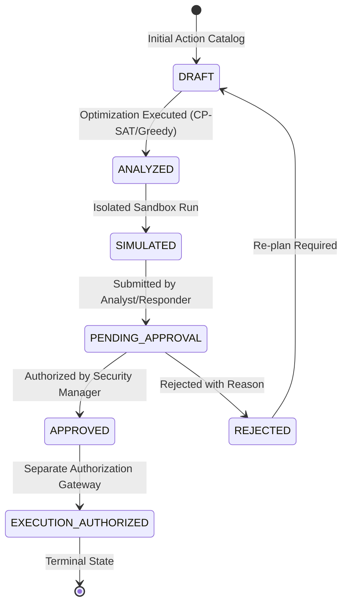

# RBAC & GOVERNANCE SPECIFICATION
## SafeContain AI — Multi-Tier Role Hierarchy & Decision State Machine
**Document Version:** 1.0.0  

---

## 1. Enterprise Role Hierarchy (7 Distinct Roles)

1. **`PLATFORM_ADMIN`:** Full administrative control, system settings, connector configuration, and final execution authorization override.
2. **`SECURITY_ADMIN`:** Network and infrastructure containment policies, credential rotation, firewall rule approval.
3. **`SECURITY_MANAGER`:** Primary containment plan approver, business continuity SLA review, incident closure authority.
4. **`INCIDENT_RESPONDER`:** Triage, candidate action synthesis, simulation sandbox execution, plan submission.
5. **`SOC_ANALYST`:** Telemetry monitoring, alert triage, session revocation, initial scenario generation.
6. **`AUDITOR`:** Read-only access to cryptographic audit ledger, verification reports, and forensic compliance dossiers.
7. **`READ_ONLY_VIEWER`:** Observability dashboard visibility, executive briefing read-only access.

---

## 2. Decision State Machine Progression

