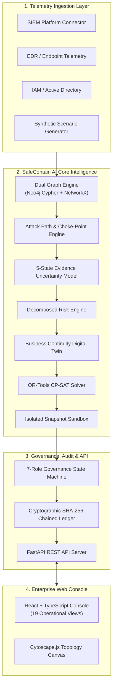

# SafeContain AI
## Uncertainty-Aware Graph-Based Cybersecurity Response Planning, Optimization, Simulation & Decision Intelligence Platform

[](https://github.com/saanviinegii/SafeContain-AI/actions)
[](#)
[](#)
[](#)
[](#)
[](#)
[](https://render.com/deploy?repo=https://github.com/saanviinegii/SafeContain-AI)

> [!TIP]
> ### 🔗 Official Project & Live Deployment Links
> - **Live Production Web Console (Render):** [https://safecontain-ai.onrender.com/](https://safecontain-ai.onrender.com/)
> - **Live Interactive Swagger API Docs:** [https://safecontain-ai.onrender.com/docs](https://safecontain-ai.onrender.com/docs)
> - **Official Project Repository:** [https://github.com/saanviinegii/SafeContain-AI](https://github.com/saanviinegii/SafeContain-AI)
> - **1-Click Local Unified Launcher:** Run `python run_app.py` or double-click `start_evaluation.bat` (Windows) / `./start_evaluation.sh` (Linux/Mac)
>   - **Unified Dashboard & API:** `http://127.0.0.1:8000/`
>   - **Interactive API Documentation:** `http://127.0.0.1:8000/docs`
>   - **System Health Endpoint:** `http://127.0.0.1:8000/api/v1/health`
> - **Presentation Pitch Deck:** [PRESENTATION_DECK.md](file:///c:/Users/saanv/Desktop/SafeContain%20AI/PRESENTATION_DECK.md)
> - **Render Operations Manual:** [RENDER_DEPLOYMENT_GUIDE.md](file:///c:/Users/saanv/Desktop/SafeContain%20AI/RENDER_DEPLOYMENT_GUIDE.md)

---

## 1. Executive Summary & Vision

**SafeContain AI** is a decision-support and simulation platform engineered to help enterprise security operations centers (SOCs), incident response teams, and critical infrastructure organizations respond to cyber incidents safely, predictably, and defensibly.

In modern IT and operational environments, blunt containment actions (such as indiscriminately isolating a subnet or terminating a core identity provider) frequently inflict catastrophic collateral disruption on essential business workflows and citizen-facing digital services. Furthermore, defensive teams frequently operate under partial, noisy, or conflicting security evidence, where blocking one visible attack vector can mistakenly be treated as complete containment while alternative, covert lateral routes remain active.

SafeContain AI addresses these core challenges through:
1. **Uncertainty-Aware Graph Intelligence:** Representing enterprise topology, permissions, and vulnerabilities in Neo4j and in-memory multigraphs with explicit epistemic confidence states (`CONFIRMED`, `SUSPECTED`, `UNKNOWN`, `DISPUTED`, `STALE`).
2. **Business Continuity Digital Twin:** Jointly modeling critical citizen and business workflows alongside IT assets to enforce zero-outage constraints during cyber containment.
3. **Tri-Level Response Optimization:** Providing mathematical comparison across Baseline Severity-First, Greedy Efficiency, and Google OR-Tools CP-SAT exact constraint-satisfaction solvers.
4. **Forensically Isolated Simulation:** Evaluating all proposed interventions on immutable graph snapshots without ever mutating the production topology.
5. **Mandatory Residual Path Verification:** Rigorously re-traversing the post-containment graph to expose alternative and newly opened attack paths.
6. **Tamper-Evident Governance:** Enforcing multi-tier role authorization (`DRAFT` $\to$ `EXECUTION_AUTHORIZED`) backed by a cryptographically chained SHA-256 audit ledger.

> [!IMPORTANT]
> **Mandatory Principle of Non-Destructive Operation:**  
> SafeContain AI is strictly a decision-support, simulation, and governance platform. It **never** independently executes destructive interventions against live infrastructure without authorized human approval and a separately controlled execution mechanism.

---

## 2. Target Audience & Operational Scenarios

- **National Cybersecurity Agencies & CERT Teams:** Evaluating multi-stage lateral threats against citizen digital infrastructure (e.g., identity registries, payment gateways, healthcare portals).
- **Enterprise SOC & Incident Response Teams:** Synthesizing cost-bounded, SLA-preserving containment actions during active ransomware or APT campaigns.
- **Critical Infrastructure Operators:** Managing power, financial, and logistics networks where availability and safety supersede blind device isolation.
- **Forensic Auditors & Compliance Officers:** Verifying that response decisions were made on defensible, timestamped evidence with mathematical justification.

---

## 3. High-Level System Architecture



---

## 4. Key Platform Innovations

- **Innovation 1: Business Continuity Digital Twin:** Models infrastructure assets directly to business workflows (e.g. payment processing, citizen portals) to estimate downtime cost and enforce SLA guarantees.
- **Innovation 2: Epistemic Uncertainty & Freshness Decay:** Automatically applies temporal exponential decay to stale evidence and models uncertainty penalties that penalize paths relying on suspected links.
- **Innovation 3: Tri-Level Optimization Comparison:** Directly compares Baseline (severity-first), Greedy (risk/cost heuristic), and CP-SAT (exact integer programming with hard budget and SLA constraints).
- **Innovation 4: Isolated Simulation Immutability:** Uses deep-copy graph snapshotting to guarantee that what-if containment simulations cannot corrupt operational state.
- **Innovation 5: Residual Path Intelligence:** Re-traverses the graph post-containment to uncover secondary lateral routes and prevent false claims of complete containment.
- **Innovation 6: Grounded Counterfactual Reasoning:** Explains why action $A$ was selected over $B$, quantifying the exact cost and disruption deltas without AI hallucination.
- **Innovation 7: Cryptographic Tamper-Evident Ledger:** Implements SHA-256 hash chaining where each decision is bound to the previous block hash, detecting tampering immediately upon verification.

---

## 5. Quick Start (Native Execution)

### Prerequisites
- Python 3.11+ (Python 3.14 compatible)
- Node.js v20+ / npm v10+
- Git

### 1. Clone & Set Up Python Environment
```bash
git clone https://github.com/safecontain/safecontain-ai.git
cd safecontain-ai

# Install Python backend dependencies
pip install -r requirements.txt
```

### 2. Run Backend Automated Test Suite
```bash
pytest -v
```
*(All 36 unit, integration, security, and benchmark tests will execute and pass.)*

### 3. Launch Unified Full-Stack Application
```bash
# One-command unified launcher (serves both React Console and FastAPI REST API on single port)
python run_app.py
```
Or launch via platform scripts:
- **Windows:** Double-click `start_evaluation.bat`
- **Linux/macOS:** `./start_evaluation.sh`

The unified console will automatically open in your default browser at:
- **Full-Stack Console:** `http://127.0.0.1:8000/`
- **Interactive OpenAPI Docs:** `http://127.0.0.1:8000/docs`

### 4. Optional: Independent Frontend Dev Server
If modifying frontend TypeScript source with hot-module reload (HMR):
```bash
cd frontend
npm install
npm run dev
```
The Vite dev console will open at `http://localhost:5173` and automatically route all API requests to `http://127.0.0.1:8000/api/v1`.

---

## 6. Docker Containerized Deployment

```bash
# Launch full stack: Backend, Frontend, Neo4j (APOC), and PostgreSQL
docker-compose up --build -d
```
- **Web Console:** `http://localhost:80`
- **FastAPI Documentation:** `http://localhost:8000/docs`
- **Neo4j Browser:** `http://localhost:7474` (Bolt: `7687`)

---

## 7. Documentation Library

Complete technical manuals and architectural designs are available in the repository root and `docs/`:

1. [SYSTEM_ARCHITECTURE.md](file:///c:/Users/saanv/Desktop/SafeContain%20AI/SYSTEM_ARCHITECTURE.md)
2. [TECHNICAL_DESIGN.md](file:///c:/Users/saanv/Desktop/SafeContain%20AI/TECHNICAL_DESIGN.md)
3. [DATABASE_SCHEMA.md](file:///c:/Users/saanv/Desktop/SafeContain%20AI/DATABASE_SCHEMA.md)
4. [NEO4J_GRAPH_SCHEMA.md](file:///c:/Users/saanv/Desktop/SafeContain%20AI/NEO4J_GRAPH_SCHEMA.md)
5. [API_DOCUMENTATION.md](file:///c:/Users/saanv/Desktop/SafeContain%20AI/API_DOCUMENTATION.md)
6. [DATA_INGESTION_GUIDE.md](file:///c:/Users/saanv/Desktop/SafeContain%20AI/DATA_INGESTION_GUIDE.md)
7. [ATTACK_PATH_METHODOLOGY.md](file:///c:/Users/saanv/Desktop/SafeContain%20AI/ATTACK_PATH_METHODOLOGY.md)
8. [UNCERTAINTY_MODEL.md](file:///c:/Users/saanv/Desktop/SafeContain%20AI/UNCERTAINTY_MODEL.md)
9. [RISK_METHODOLOGY.md](file:///c:/Users/saanv/Desktop/SafeContain%20AI/RISK_METHODOLOGY.md)
10. [OPTIMIZATION_METHODOLOGY.md](file:///c:/Users/saanv/Desktop/SafeContain%20AI/OPTIMIZATION_METHODOLOGY.md)
11. [SIMULATION_METHODOLOGY.md](file:///c:/Users/saanv/Desktop/SafeContain%20AI/SIMULATION_METHODOLOGY.md)
12. [BUSINESS_CONTINUITY_MODEL.md](file:///c:/Users/saanv/Desktop/SafeContain%20AI/BUSINESS_CONTINUITY_MODEL.md)
13. [SECURITY_THREAT_MODEL.md](file:///c:/Users/saanv/Desktop/SafeContain%20AI/SECURITY_THREAT_MODEL.md)
14. [RBAC_AND_GOVERNANCE.md](file:///c:/Users/saanv/Desktop/SafeContain%20AI/RBAC_AND_GOVERNANCE.md)
15. [AUDIT_AND_INTEGRITY_DESIGN.md](file:///c:/Users/saanv/Desktop/SafeContain%20AI/AUDIT_AND_INTEGRITY_DESIGN.md)
16. [COMPLIANCE_MAPPING.md](file:///c:/Users/saanv/Desktop/SafeContain%20AI/COMPLIANCE_MAPPING.md)
17. [TESTING_STRATEGY.md](file:///c:/Users/saanv/Desktop/SafeContain%20AI/TESTING_STRATEGY.md)
18. [PERFORMANCE_BENCHMARKS.md](file:///c:/Users/saanv/Desktop/SafeContain%20AI/PERFORMANCE_BENCHMARKS.md)
19. [DEPLOYMENT_GUIDE.md](file:///c:/Users/saanv/Desktop/SafeContain%20AI/DEPLOYMENT_GUIDE.md)
20. [BACKUP_AND_DISASTER_RECOVERY.md](file:///c:/Users/saanv/Desktop/SafeContain%20AI/BACKUP_AND_DISASTER_RECOVERY.md)
21. [USER_GUIDE.md](file:///c:/Users/saanv/Desktop/SafeContain%20AI/USER_GUIDE.md)
22. [ADMINISTRATOR_GUIDE.md](file:///c:/Users/saanv/Desktop/SafeContain%20AI/ADMINISTRATOR_GUIDE.md)
23. [RESEARCH_CONTRIBUTION.md](file:///c:/Users/saanv/Desktop/SafeContain%20AI/RESEARCH_CONTRIBUTION.md)
24. [KNOWN_LIMITATIONS.md](file:///c:/Users/saanv/Desktop/SafeContain%20AI/KNOWN_LIMITATIONS.md)
25. [FINAL_IMPLEMENTATION_STATUS.md](file:///c:/Users/saanv/Desktop/SafeContain%20AI/FINAL_IMPLEMENTATION_STATUS.md)

---

## 8. License & Attribution

SafeContain AI is released under the Apache-2.0 License. All synthetic demonstration data is explicitly isolated from operational systems.
