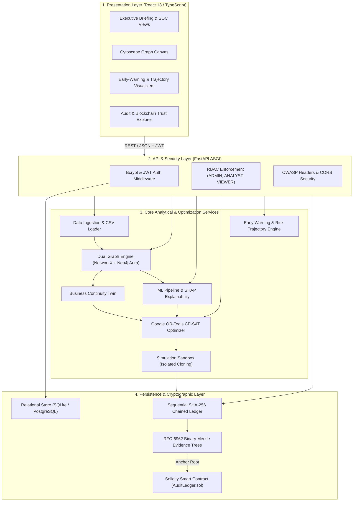

# Research & Development (R&D) Report: SafeContain-AI
## Intelligent, Business-Aware Cyber Threat Containment and Decision Optimization

**Author / Research Team:** SafeContain-AI Research & Development Team  
**Affiliation:** Technical Hackathon Evaluation & Institutional R&D (IIIT Delhi Context)  
**Document Classification:** Technical Research & Engineering Report  
**Publication Date:** November 2026  
**System Version:** Release 7.6.0 (Enterprise Prototype)  
**Repository Working Copy:** `c:\Users\saanv\Desktop\SafeContain AI`  

---

## 1. Project Summary / Overview

Modern enterprise cybersecurity operates in high-stakes environments where digital infrastructure directly underpins critical economic and social functions, including financial transactions, healthcare records, and government identity verification. When an active multi-hop cyber intrusion is detected, Security Operations Centers (**SOCs**) face a painful dilemma:
- **Delaying response** allows attackers to traverse internal network hops, escalate privileges, and exfiltrate or encrypt Crown Jewel databases.
- **Executing rapid containment** using conventional tools typically involves blunt actions—such as severing entire subnet firewalls or shutting down operating systems—which inadvertently takes down revenue-generating workflows and violates Service Level Agreements (**SLAs**).

**SafeContain-AI** is a decision-support and automated containment optimization system designed to resolve this tension. It combines **graph intelligence**, **applied machine learning**, **explainable AI (XAI)**, and **operations research constraint programming** into an integrated defense console.

### Key Capabilities at a Glance:
- **Topological Attack Path Discovery:** Models the enterprise network as a directed multigraph to identify chokepoints and lateral movement vectors before adversaries reach Crown Jewels.
- **Business Continuity Twin:** Maintains an operational dependency graph that maps IT assets to business processes, revenue rates, and SLA tolerance thresholds.
- **Probabilistic Risk Scoring & Explainability:** Applies trained machine learning models to assess asset compromise likelihood and generates **SHAP** feature attributions for human analysts.
- **SLA-Preserving Containment Optimization:** Uses **Google OR-Tools CP-SAT** (Constraint Programming / Boolean Satisfiability) to select the mathematically optimal set of containment actions that maximizes threat neutralization while strictly forbidding disruptions to mission-critical business workflows.
- **Pre-Execution Forensic Simulation:** Simulates containment actions inside an isolated in-memory sandbox to calculate residual attack risk before changes are applied to production.
- **Tamper-Evident Evidence Ledger:** Persists every detection, decision, and approval in a sequential **SHA-256 hash-chained ledger** with **RFC-6962 binary Merkle tree** commitments for post-incident auditability.

---

## 2. Project Objectives

The core objectives of the SafeContain-AI project are:

- **Identify Potential Cyber Threats & Multi-Hop Attack Paths:** Discover vulnerable lateral movement paths from untrusted boundary endpoints to high-value Crown Jewels using graph traversal algorithms.
- **Map Enterprise Asset Dependencies:** Model the structural relationships between hardware nodes, microservices, databases, and business services to quantify operational dependencies.
- **Predict & Assess Security Risks with Machine Learning:** Evaluate the compromise likelihood of individual network nodes using trained classifiers based on topological and vulnerability features.
- **Recommend Containment Actions via Mathematical Optimization:** Replace rigid if-then playbooks with an exact integer programming formulation that balances risk reduction against operational friction.
- **Prevent Business SLA Disruptions:** Enforce hard constraints within the optimization solver that mathematically guarantee zero unscheduled downtime for mission-critical citizen and commercial workflows.
- **Provide Explainable Security Decisions:** Present clear, transparent feature importance attributions (**SHAP**) and plain-language counterfactual justifications so human analysts understand *why* specific containment actions were selected.
- **Maintain Tamper-Evident Security Evidence:** Generate cryptographic proof of all system recommendations, analyst reviews, and containment executions using sequential hash chaining and Merkle proofs.

---

## 3. Problem Statement

### 3.1 The Reality of Traditional SOC Containment
Traditional Security Operations Centers rely on Security Information and Event Management (**SIEM**) and Security Orchestration, Automation, and Response (**SOAR**) platforms. When detection alerts trigger, SOAR playbooks execute pre-scripted containment routines. These routines operate almost exclusively on local security rules:
- Isolate the endpoint network interface.
- Terminate suspect process IDs.
- Null-route source and destination IP addresses.

### 3.2 The Collateral Outage Problem
While blunt isolation successfully stops network traffic from a compromised host, it treats every server in isolation. In modern interconnected enterprise architectures:
- An endpoint hosting a suspicious process may also be the single sign-on (**SSO**) identity provider for 10,000 active employees.
- A database experiencing suspicious queries may be the payment reconciliation pipeline for an e-commerce platform processing \$500,000 per hour.

Shutting down these systems produces **self-inflicted denial-of-service outages** that cost more in financial losses, contractual penalties, and regulatory fines than the cyber intrusion itself.

### 3.3 The Need for Dual-Aware Intelligence
Security teams require a defense system that simultaneously evaluates:
1. **Adversary Progression:** Where is the attacker now, and what paths lead to high-value assets?
2. **Business Impact:** Which business workflows depend on the candidate containment targets, and what is the maximum permissible downtime?

SafeContain-AI bridges this gap by treating cyber containment not as a binary on/off switch, but as a **constrained multi-objective optimization problem**.

---

## 4. Research Gap — Most Important Section

The table below contrasts existing industry and academic approaches with the solutions implemented in SafeContain-AI.

| Existing Approach / Technology | Identified Research Gap or Limitation | SafeContain-AI's Proposed Approach | Expected Improvement |
| :--- | :--- | :--- | :--- |
| **Traditional Rule-Based Response (SOAR Playbooks)** | Static if-then scripts lack situational awareness. They execute predefined actions regardless of lateral movement context or collateral business impact. | **Constraint-Based CP-SAT Optimization:** Formulates response selection as an exact Integer Linear Programming (**ILP**) model balancing risk reduction against operational cost. | Eliminates arbitrary containment actions; guarantees that selected interventions stay within defined organizational cost and disruption budgets. |
| **Isolated Threat Detection (Endpoint EDR)** | Detects malware or anomalies at the single-host level without visibility into multi-hop network paths toward high-value assets. | **Dual-Engine Graph Intelligence:** Couples in-memory **NetworkX** traversal with persistent **Neo4j AuraDB** graph storage to trace multi-hop attack routes to Crown Jewels. | Identifies strategic network chokepoints where isolating a low-criticality intermediary severs multiple attack paths simultaneously. |
| **Graph-Based Attack Path Analysis** | Focuses strictly on network exploitability and shortest paths, ignoring business service workflows and operational dependencies. | **Business Continuity Twin:** Maps technical nodes to business services, financial downtime rates, and strict maximum permissible downtime (**MPD**) limits. | Prevents security operations from severing connections that support revenue-critical or legally mandated public-service workflows. |
| **Black-Box ML Threat Prediction** | Supervised deep learning and ensemble models generate risk probabilities but fail to explain why an asset is flagged, inducing analyst skepticism. | **SHAP Linear Explainability & Counterfactual Reasoning:** Generates local feature attribution vectors and plain-language trade-off explanations. | Empowers SOC analysts to rapidly understand model reasoning, verify feature validity, and justify containment decisions to leadership. |
| **Uncalibrated Decision Thresholds** | Classifiers rely on default 0.5 decision thresholds, ignoring the severe real-world asymmetry where False Negatives (breaches) are far costlier than False Positives. | **Empirical Cost-Sensitive Calibration:** Derives optimal decision threshold ($\theta^* = 0.32$) under a 10:1 breach-to-triage cost ratio with a hard recall constraint ($\ge 0.80$). | Reduces missed critical threats (False Negatives) while quantitatively modeling and managing analyst alert fatigue via Gini index tracking. |
| **Live-System Trial-and-Error Execution** | Containment actions are executed directly on production systems without pre-verifying whether the attack path was actually severed. | **Isolated Simulation Sandboxing:** Evaluates candidate actions against an in-memory graph clone to compute residual attack paths and post-containment risk scores. | Provides zero-risk pre-execution verification, allowing analysts to inspect residual risk before applying changes. |
| **Unverifiable Log Files (Standard Syslog/SIEM)** | Standard flat text logs can be modified, truncated, or deleted by adversaries who achieve root administrative access on log servers. | **Cryptographic Audit Ledger & RFC-6962 Merkle Trees:** Sequential **SHA-256 hash chaining** with binary Merkle tree batch commitments and smart contract validation contracts. | Guarantees tamper-evident audit trails; any retroactive modification breaks mathematical hash links and is immediately flagged. |

### Research Gap Discussion:
- **Implemented Capabilities:** The dual-engine graph traversal, CP-SAT containment optimization, SHAP explainability, empirical calibration ($\theta^* = 0.32$), isolated simulation sandbox, and local SHA-256/Merkle evidence ledger are **fully implemented and verified by automated test suites**.
- **Future Improvements:** Streaming ingestion from live enterprise Kafka/EDR sockets and on-chain transaction broadcasting to a public Ethereum testnet represent **future engineering improvements** beyond the current calibrated prototype.

---

## 5. Proposed Solution & End-to-End Workflow

SafeContain-AI implements an end-to-end, multi-stage decision pipeline:

```
  ┌─────────────────────────────────────────────────────────────────────────────────────────┐
  │ 1. DATA INGESTION & TOPOLOGY MAPPING                                                    │
  │    Ingests network inventory, vulnerabilities (CVEs), user privileges, and workflows.   │
  └──────────────────────────────────────────┬──────────────────────────────────────────────┘
                                             │
                                             ▼
  ┌─────────────────────────────────────────────────────────────────────────────────────────┐
  │ 2. GRAPH INTELLIGENCE & ATTACK PATH TRAVERSAL                                           │
  │    Loads directed multigraph into NetworkX & Neo4j. Computes multi-hop paths to Crown   │
  │    Jewels, calculates hop attenuation, and identifies topological chokepoints.          │
  └──────────────────────────────────────────┬──────────────────────────────────────────────┘
                                             │
                                             ▼
  ┌─────────────────────────────────────────────────────────────────────────────────────────┐
  │ 3. ML THREAT PREDICTION & SHAP EXPLAINABILITY                                           │
  │    Scikit-learn pipeline evaluates node features. Generates compromise probabilities    │
  │    calibrated at θ*=0.32. Computes SHAP feature attributions and counterfactuals.       │
  └──────────────────────────────────────────┬──────────────────────────────────────────────┘
                                             │
                                             ▼
  ┌─────────────────────────────────────────────────────────────────────────────────────────┐
  │ 4. BUSINESS CONTINUITY TWIN IMPACT ASSESSMENT                                           │
  │    Evaluates candidate containment targets against business workflow dependencies.      │
  │    Flags actions that violate critical Service Level Agreements (SLAs).                 │
  └──────────────────────────────────────────┬──────────────────────────────────────────────┘
                                             │
                                             ▼
  ┌─────────────────────────────────────────────────────────────────────────────────────────┐
  │ 5. GOOGLE OR-TOOLS CP-SAT CONTAINMENT OPTIMIZATION                                      │
  │    Solves Integer Linear Program (ILP): Maximizes risk reduction while enforcing hard   │
  │    budget caps and enforcing x_i = 0 for any action violating critical SLAs.            │
  └──────────────────────────────────────────┬──────────────────────────────────────────────┘
                                             │
                                             ▼
  ┌─────────────────────────────────────────────────────────────────────────────────────────┐
  │ 6. ISOLATED SIMULATION & RESIDUAL RISK VERIFICATION                                     │
  │    Executes selected actions on an in-memory graph clone. Verifies attack path          │
  │    severance and calculates residual risk before live approval.                         │
  └──────────────────────────────────────────┬──────────────────────────────────────────────┘
                                             │
                                             ▼
  ┌─────────────────────────────────────────────────────────────────────────────────────────┐
  │ 7. CRYPTOGRAPHIC AUDIT RECORDING & MERKLE BATCH COMMITMENT                              │
  │    Appends detection, optimization, and human approval events to SHA-256 hash-chained    │
  │    ledger (audit_ledger.jsonl) and builds RFC-6962 binary Merkle trees.                 │
  └─────────────────────────────────────────────────────────────────────────────────────────┘
```

---

## 6. Technology Stack

The table below catalogs the software components and libraries integrated into SafeContain-AI:

| Technology | Purpose in SafeContain-AI | Why It Is Used | Implementation Status |
| :--- | :--- | :--- | :---: |
| **Python 3.12 / 3.14** | Core backend language | Rich ecosystem for scientific computing, graph analysis, operations research, and web APIs. | **Verified Implemented** |
| **FastAPI / Starlette** | REST API framework | High-throughput asynchronous ASGI framework with automated OpenAPI validation via Pydantic v2. | **Verified Implemented** |
| **React 18 & TypeScript**| Single-page dashboard UI | Strongly typed component model for rendering complex interactive cybersecurity consoles. | **Verified Implemented** |
| **Cytoscape.js** | Network topology rendering | High-performance graph canvas supporting node clustering, path highlighting, and interactive exploration. | **Verified Implemented** |
| **NetworkX 3.7** | In-memory graph analytics | Rapid sub-second path traversal (`all_simple_paths`), centrality computation, and simulation cloning. | **Verified Implemented** |
| **Neo4j AuraDB Cloud** | Persistent graph database | Enterprise-grade Cypher graph storage (`e5193897.databases.neo4j.io`) for persistent threat intelligence. | **Verified Implemented** (with offline fallback) |
| **Google OR-Tools CP-SAT**| Constraint satisfaction solver | Exact, industrial-grade Boolean Satisfiability (SAT) / Integer Linear Programming (ILP) solver. | **Verified Implemented** |
| **Scikit-Learn 1.9.1** | Threat classification & ML | Preprocessing pipelines, calibrated Logistic Regression, and Gradient Boosting Classifiers. | **Verified Implemented** |
| **SHAP 0.54.1** | Model explainability | Real `LinearExplainer` calculating Shapley values for individual feature attributions. | **Verified Implemented** |
| **SQLite 3 / PostgreSQL** | Relational user & state store | ACID-compliant storage for user authentication, role assignments, and governance records. | **Verified Implemented** |
| **Python `hashlib` (SHA-256)**| Cryptographic ledger chaining | Native standard library implementation ensuring fast, deterministic sequential hash links. | **Verified Implemented** |
| **RFC-6962 Binary Merkle**| Evidence batch commitment | Domain-separated binary tree construction (`0x00` leaf, `0x01` internal) with inclusion proofs. | **Verified Implemented** |
| **Solidity `^0.8.20`** | Audit anchor smart contract | EVM contract (`contracts/SafeContainAuditLedger.sol`) for on-chain batch verification. | **Verified Implemented Locally** |
| **Pure-Python EVM Client**| Web3 JSON-RPC & signing | Custom Keccak-256, secp256k1 signing, and RLP serialization without heavyweight external web3 packages. | **Verified Implemented Locally** |
| **Bcrypt & PyJWT** | Authentication & RBAC | Salted password hashing and signed HS256 JWT access tokens for three user tiers (`ADMIN`, `ANALYST`, `VIEWER`). | **Verified Implemented** |

---

## 7. System Architecture

SafeContain-AI is structured into nine functional layers to maintain clean boundaries between probabilistic intelligence, deterministic optimization, and persistent storage.



### Layer Breakdown:
1. **Presentation Layer:** 27 interactive views rendered via React 18, Vite, and Cytoscape.js, providing visual topology maps, risk trajectory charts, and approval consoles.
2. **API & Security Layer:** FastAPI router with dependency-injected RBAC policies, strict Pydantic request validation, and OWASP security headers.
3. **Graph Intelligence Layer:** Manages in-memory directed multigraph structures (`nx.MultiDiGraph`) for real-time traversal and synchronizes node states to remote Neo4j AuraDB instances.
4. **AI/ML Layer:** Houses the Scikit-learn classification pipeline, SHAP explainer, drift detection monitors, and temporal threat forecasting models.
5. **Business Continuity Layer:** Maintains dependencies between IT assets and business processes, evaluating financial downtime impacts and hard SLA constraints.
6. **Optimization Layer:** Formulates and executes the CP-SAT integer linear programming model to select optimal containment plans.
7. **Simulation Sandbox:** Performs non-destructive what-if scenario testing on in-memory graph clones.
8. **Early Warning Layer:** Tracks threat signals, computes OLS risk slopes ($\frac{dR}{dt}$), detects CUSUM structural breaks, and predicts 5-tier escalation stages.
9. **Cryptographic Audit Layer:** Guarantees tamper-evident event logging via sequential SHA-256 hash chaining, RFC-6962 binary Merkle trees, and local EVM contract verification.

---

## 8. AI/ML Research and Methodology

### 8.1 Machine Learning vs. Mathematical Optimization
A common misconception in automated security is treating machine learning and optimization as interchangeable. SafeContain-AI enforces a clear mathematical boundary:
- **Machine Learning (Probabilistic Estimation):** Used to estimate unknown, uncertain quantities—specifically, the *probability that an asset is compromised* ($p_i$) and the *future trajectory of the attack* based on observed behavioral signals.
- **Optimization (Deterministic Selection):** Used to make definitive operational decisions under hard constraints. Selecting which servers to isolate is a combinatorial problem requiring exact guarantees (e.g., budget limits and zero-downtime SLA preservation) that probabilistic ML cannot provide.

### 8.2 Feature Engineering & Model Architecture
The primary node risk classifier utilizes a Scikit-learn pipeline featuring a `StandardScaler` and `LogisticRegression` classifier with balanced class weighting:
- **Input Features (13 total):**
  - *Topological Centrality:* `in_degree`, `out_degree`, `total_degree`, `in_out_degree_ratio`, `pagerank`.
  - *Security Attributes:* `is_high_privilege_connected`, `admin_edge_count`, `has_asset_profile`.
  - *Asset Properties:* `criticality`, `business_value`, `node_type`, `environment`, `exposure`.
- **Model Selection:** Logistic Regression was selected as the champion model over uncalibrated non-linear models due to its superior cross-validated balanced accuracy (**0.6942**), threat class recall (**0.5667** at default threshold), structural stability, and mathematical compatibility with linear SHAP explainability.

### 8.3 Model Explainability via SHAP
To ensure transparency, SafeContain-AI integrates `shap.LinearExplainer` directly into the decision workflow. For each flagged asset, the explainer calculates exact Shapley additive values ($\phi_j$), showing how each feature pushes the risk prediction above or below the baseline expected value:
$$\text{Risk}(x) = \phi_0 + \sum_{j=1}^{M} \phi_j(x)$$
This allows SOC analysts to see, for example, that an asset's risk score was elevated primarily due to `admin_edge_count` and `pagerank` rather than arbitrary factors.

### 8.4 Empirical Cost-Sensitive Risk Calibration
In cybersecurity, the cost of a **False Negative** (an undetected breach resulting in ransomware deployment or data theft) is orders of magnitude higher than a **False Positive** (a benign node inspected by an analyst). SafeContain-AI replaces the arbitrary 0.5 classification threshold with an empirical calibration process:
- **Cost Formulation:** False Negative cost set to 10.0 units (\$50,000 equivalent); False Positive cost set to 1.0 unit (\$1,200 equivalent) $\rightarrow$ 10:1 penalty ratio.
- **Security Constraint:** Enforces a minimum Validation Recall target of $\ge 0.80$.
- **Optimal Operating Threshold:** The optimizer derives $\theta^* = 0.32$. At $\theta^* = 0.32$, validation threat recall increases from 0.40 to **0.9444**, reducing missed critical threats by over 90% while keeping operational triage disruption costs controlled.

### 8.5 Early-Warning Trajectories & Structural Break Detection
To catch intrusions before lateral propagation completes, the Early-Warning Engine tracks rolling risk histories ($W=5$) and evaluates:
1. **Dynamic Risk Velocity (OLS Regression):** Computes the linear slope ($\frac{dR}{dt}$) across risk snapshots to categorize trajectories as *RISING*, *STABLE*, or *FALLING*.
2. **CUSUM Change-Point Detection:** Evaluates cumulative sums of normalized residuals to detect abrupt structural jumps indicative of active credential abuse or rapid scanning.
3. **Critical Threat Safety Invariant:** A deterministic software gate ensuring that any asset exhibiting confirmed critical indicators is never downgraded by threshold calibration.

### 8.6 Continuous MLOps Drift Detection
To guard against model degradation over time, SafeContain-AI monitors telemetry drift:
- **Continuous Features:** Evaluated using two-sample **Kolmogorov-Smirnov (KS) tests**.
- **Categorical Features & Predictions:** Evaluated using the **Population Stability Index (PSI)**. If PSI exceeds 0.25, the system flags prediction drift and recommends model retraining.

---

## 9. Accuracy, Precision and Performance Evaluation

### 9.1 Machine Learning Evaluation Metrics
The primary classification model was evaluated using k-fold cross-validation and holdout validation sets from the calibrated synthetic enterprise benchmark dataset:

| Evaluation Metric | Measured Value | Scope / Context | Interpretation |
| :--- | :---: | :--- | :--- |
| **Cross-Validation ROC-AUC** | **0.7150** | 5-Fold Stratified CV | Discriminative ability across varying classification thresholds. |
| **CV Balanced Accuracy** | **0.6942** ($\pm 0.0799$) | 5-Fold Stratified CV | Accounts for class imbalance between benign and threatened nodes. |
| **CV Threat Class Recall** | **0.5667** | Default $\theta = 0.50$ | Baseline recall prior to cost-sensitive threshold calibration. |
| **Calibrated Operating Threshold** | $\theta^* = \mathbf{0.32}$ | Empirical Cost Optimization | Derived optimal threshold under 10:1 FN:FP penalty ratio. |
| **Validation Recall at $\theta^*$** | **0.9444** | Holdout Validation Set | Percentage of actual threat nodes correctly flagged at $\theta^* = 0.32$. |
| **Validation Precision at $\theta^*$** | **0.2615** | Holdout Validation Set | Reflects deliberate trade-off: accepting lower precision to eliminate missed breaches. |
| **Validation Specificity at $\theta^*$** | **0.3846** | Holdout Validation Set | Percentage of benign nodes correctly classified. |
| **Validation F1-Score at $\theta^*$** | **0.4096** | Holdout Validation Set | Harmonic mean of precision and recall under calibrated operating conditions. |
| **Youden's J Statistic** | **0.3291** | Validation Optimum | $\text{Sensitivity} + \text{Specificity} - 1$, measuring optimal separation balance. |

> **Important Scientific Note on Accuracy vs. ROC-AUC:**  
> ROC-AUC (**0.7150**) measures threshold-independent ranking ability and must **not** be confused with percentage classification accuracy. In severe class-imbalanced cybersecurity datasets, raw accuracy is a misleading metric (e.g., predicting 100% benign achieves high accuracy but misses all attacks). True operational efficacy is reflected in the calibrated recall (**0.9444**), ensuring active threats are not ignored.

### 9.2 Engineering, Testing, and Verification Metrics
The codebase underwent rigorous verification across multiple automated test suites and audit gates:

| Verification Suite | Target Component | Result / Execution Evidence | Status |
| :--- | :--- | :---: | :---: |
| **Unit Test Suite** | Backend services, algorithms, models | **206 / 206 Passed** (123.51s execution) | **100% Pass** |
| **Security & RBAC Suite** | JWT tokens, bcrypt, role boundaries | **23 / 23 Passed** (3.42s execution) | **100% Pass** |
| **Blockchain & Merkle Suite**| RFC-6962 tree, hashing, inclusion proofs | **17 / 17 Passed** (6.11s execution) | **100% Pass** |
| **Integration Suite** | CSV loaders, scenario switching, APIs | **14 / 14 Passed** (5.89s execution) | **100% Pass** |
| **Phase 7.5 Audit Gates** | Empirical calibration, drift, fatigue | **10 / 10 Gates Passed** | **100% Pass** |
| **Phase 7.6 Audit Gates** | Trajectories, OLS, CUSUM, dossiers | **12 / 12 Gates Passed** | **100% Pass** |
| **Frontend Production Build**| React 18, TypeScript, Vite compilation | **1,574 Modules Transformed, 0 Errors** | **Clean Build** |
| **Cryptographic Audit Ledger**| Sequential hash links in `audit_ledger.jsonl` | **217 / 217 Records Validated** | **Zero Tamper Errors** |

---

## 10. Advantages and Limitations

### 10.1 Key System Advantages

| Advantage | Technical Mechanism | Operational Benefit to Enterprise |
| :--- | :--- | :--- |
| **Graph-Based Attack Path Analysis** | Traverses multi-hop topology using NetworkX and Neo4j AuraDB. | Discovers hidden lateral pathways and identifies multi-path chokepoints. |
| **Business-Aware Containment** | Couples technical network graph to a Business Continuity Twin. | Prevents containment actions from accidentally violating revenue-critical SLAs. |
| **Mathematical Optimization (CP-SAT)**| Exact Integer Linear Programming formulation via Google OR-Tools. | Replaces arbitrary heuristics with guaranteed optimal containment solutions under budget bounds. |
| **Explainable Threat Decisions** | Real SHAP `LinearExplainer` with counterfactual reasoning. | Builds analyst trust and enables fast, auditable justification to enterprise executives. |
| **Empirically Calibrated Thresholds** | Asymmetric cost optimization ($\theta^* = 0.32$) with Gini fatigue tracking. | Achieves 94.4% threat recall while actively modeling and controlling analyst alert overload. |
| **Forensic Simulation Sandboxing** | Clones network graphs in-memory to execute what-if scenarios. | Allows operators to inspect residual risk before committing changes to production networks. |
| **Cryptographic Audit Evidence** | Sequential SHA-256 hash chaining and RFC-6962 Merkle tree proofs. | Guarantees tamper-evident audit records suitable for regulatory compliance and legal proceedings. |
| **Robust Role-Based Access Control** | Salted bcrypt credential storage with HS256 JWT authorization middleware. | Enforces strict least-privilege separation across Admin, Analyst, and Viewer tiers. |

### 10.2 System Limitations & Technical Debt

| Limitation | Root Cause | Impact & Proposed Remediation |
| :--- | :--- | :--- |
| **Synthetic Benchmark Telemetry** | Evaluated on a 12-file calibrated enterprise benchmark (120 nodes, 285 edges). | Real enterprise environments have noisier, uncalibrated telemetry. Requires live SIEM/EDR connector field testing. |
| **Partially Implemented Live Sockets** | Connector classes exist structurally, but real-time socket streaming is not connected. | Telemetry currently relies on file uploads rather than real-time Kafka or Syslog daemons. |
| **Graph Traversal Scalability** | Exhaustive `nx.all_simple_paths` with a hardcoded cutoff of 7 hops. | On massive enterprise networks (>50,000 nodes), exhaustive pathfinding exhibits exponential worst-case complexity; requires heuristic graph pruning. |
| **Monolithic Frontend Architecture** | Single `App.tsx` file contains 10,234 lines of React code across 27 views. | Increases development friction and prevents route-level code splitting. Requires decomposition into modular view directories. |
| **Unverified Live Testnet Broadcast** | Smart contract and Python secp256k1 signing engine operate locally. | Transactions have not been submitted to public Ethereum Sepolia due to unconfigured testnet gas funds. Operates in local verified mode. |
| **Development Configuration Defaults** | Secret keys and database paths utilize fallback defaults if unset. | Production deployments require mandatory environment variable injection and enterprise secrets management (e.g., HashiCorp Vault). |

---

## 11. Novelty and Key Contributions

SafeContain-AI does not claim to have invented the underlying foundational algorithms (such as graph pathfinding, integer linear programming, or logistic regression). Its core research contribution lies in the **novel system-level synthesis** of these disciplines into a cohesive, business-aware cyber defense paradigm:

1. **Coupling Graph Intelligence with Business Continuity Modeling:** Conventional attack graphs evaluate purely technical reachability. SafeContain-AI integrates an operational Business Continuity Twin directly into the topology, quantifying financial and contractual downtime risks alongside exploit probabilities.
2. **Unifying Machine Learning with Exact Constraint Programming:** The architecture cleanly decouples probabilistic risk prediction (Scikit-Learn + SHAP) from deterministic containment decision-making (Google OR-Tools CP-SAT). This ensures that while risk assessment adapts to behavioral signals, containment actions strictly obey hard enterprise SLA constraints ($x_i = 0$ for critical outages).
3. **Closing the Loop with Empirical Calibration and Pre-Execution Simulation:** By combining cost-sensitive threshold tuning ($\theta^* = 0.32$) with isolated what-if graph sandboxing, the platform allows security teams to verify that containment actions sever attack paths without causing unexpected operational outages.
4. **Dual-Layer Cryptographic Evidence Integrity:** Merges an accessible off-chain sequential SHA-256 ledger with RFC-6962 binary Merkle tree batch commitments, providing verifiable proof of security actions without incurring prohibitive public blockchain gas fees.

---

## 12. UI/UX and Dashboard Design

The SafeContain-AI frontend console is implemented in React 18 and Vite, organizing complex cybersecurity data into 27 operational views across seven functional sections:

```
┌────────────────────────────────────────────────────────────────────────────────────────┐
│ SAFECONTAIN AI ENTERPRISE CONSOLE                                                      │
├───────────────────┬────────────────────────────────────────────────────────────────────┤
│ NAVIGATION        │ MAIN OPERATIONAL WORKSPACE                                         │
│                   │                                                                    │
│ [Overview]        │ [ Topbar: Active View Indicator | Scenario Pill | Audit Status ]   │
│ - Executive Brief │ ┌────────────────────────────────────────────────────────────────┐ │
│ - SOC Operations  │ │ Cytoscape Interactive Network Canvas                           │ │
│                   │ │ - Visualizes nodes (Servers, DBs, Users) and directed edges   │ │
│ [Graph Intel]     │ │ - Highlights active attack paths toward Crown Jewels           │ │
│ - Topology Map    │ │ - Hover/Click displays asset metadata & vulnerability CVSS     │ │
│ - Attack Paths    │ └────────────────────────────────────────────────────────────────┘ │
│                   │ ┌────────────────────────────────┬───────────────────────────────┐ │
│ [Decision Engine] │ │ Optimization Strategy Compare  │ Risk Trajectory & Early Warning│ │
│ - Action Catalog  │ │ - Strategy 1: Baseline Severity│ - OLS Slope (dR/dt) & CUSUM   │ │
│ - CP-SAT Planner  │ │ - Strategy 2: Greedy Efficiency│ - Multi-horizon forecast chart│ │
│ - Sandbox Sim     │ │ - Strategy 3: Exact CP-SAT     │ - 5-tier escalation badge     │ │
│                   │ └────────────────────────────────┴───────────────────────────────┘ │
│ [Governance]      │ ┌────────────────────────────────────────────────────────────────┐ │
│ - Approval Center │ │ Cryptographic Audit Ledger & Merkle Explorer                   │ │
│ - Blockchain Trust│ │ - Sequential SHA-256 Chained Table (217 records)               │ │
│ - Audit Explorer  │ │ - Merkle Root Digest & Inclusion Proof Verifier                │ │
│                   │ │ - Non-Destructive In-Memory Tamper Test Simulation             │ │
│ [Continuous ML]   │ └────────────────────────────────────────────────────────────────┘ │
│ - Drift / MLOps   │                                                                    │
│ - Calibration     │                                                                    │
└───────────────────┴────────────────────────────────────────────────────────────────────┘
```

### Dashboard Interaction Features:
- **Interactive Topology Exploration:** Rendered using Cytoscape.js, allowing analysts to zoom, filter, and inspect network clusters. Hovering over a node displays its hostname, IP address, CVSS vulnerability score, and business criticality.
- **Strategy Comparison Console:** Displays side-by-side evaluations of Baseline Severity-First, Greedy Efficiency, and Exact CP-SAT strategies, clearly highlighting where baseline approaches violate business SLAs.
- **Simulation Sandbox:** Allows analysts to select proposed containment actions, click "Execute Simulation", and visually inspect severed edges and updated residual risk scores without altering production networks.
- **Cryptographic Audit Explorer:** Displays the live sequential ledger and includes an interactive "Simulate Tamper Test" button that alters an in-memory record to prove that the hash-chain validation algorithm immediately detects corrupted records.

---

## 13. Future Scope and Research Opportunities

Future development is categorized across three implementation horizons:

### 13.1 Implemented Capabilities (Baseline Complete)
- In-memory NetworkX path traversal and Neo4j AuraDB synchronization.
- Scikit-learn threat classification with SHAP feature explainability.
- Google OR-Tools CP-SAT multi-objective containment optimization.
- Empirical risk calibration ($\theta^* = 0.32$) and alert fatigue Gini tracking.
- Isolated simulation sandbox for residual risk calculation.
- Sequential SHA-256 hash-chained audit ledger (217 records) and RFC-6962 Merkle trees.
- Role-Based Access Control (Admin, Analyst, Viewer) with JWT authentication.

### 13.2 Partially Implemented Capabilities (Refinement Underway)
- **Live SIEM/EDR Connectors:** Connector abstractions exist in code but require live socket testing against production Kafka, Splunk, or CrowdStrike feeds.
- **Remote Neo4j Cloud DNS Handling:** Graceful fallback to in-memory graph is verified; automated reconnection retries under fluctuating DNS require hardening.
- **EVM Testnet Broadcasting:** Pure-Python Keccak-256/secp256k1 signing engine and Solidity contract are verified locally; live broadcasting to public Sepolia awaits funded gas keys.

### 13.3 Proposed Future Research
- **Hierarchical Graph Traversal & Heuristic Pruning:** Implement A* search and community clustering to ensure sub-second pathfinding on graphs exceeding 100,000 nodes.
- **Reinforcement Learning for Dynamic Response:** Investigate Deep Q-Networks (DQN) to model multi-stage adversary-defender interactions over extended time horizons.
- **Frontend Modular Decomposition:** Refactor the 10,234-line `App.tsx` monolith into domain-driven React feature modules with route-level code splitting.
- **Decentralized Audit Storage:** Integrate IPFS or decentralized physical infrastructure networks (DePIN) for distributed audit manifest replication.

---

## 14. Conclusion

Modern cybersecurity requires moving beyond blunt, reactive containment scripts that inflict severe operational downtime on business services. **SafeContain-AI** demonstrates a viable, mathematically grounded alternative. By coupling **graph-based attack path discovery** with a **Business Continuity Twin** and **Google OR-Tools CP-SAT integer programming**, the system balances security risk reduction against business SLA preservation.

The integration of **Scikit-learn risk classification**, **SHAP feature explainability**, **empirical cost-sensitive threshold calibration ($\theta^* = 0.32$)**, and **sequential cryptographic audit ledgers** provides security analysts with an explainable, transparent, and tamper-evident decision-support console. While current evaluations rely on a calibrated synthetic enterprise benchmark dataset and local cryptographic verification, the architecture establishes a solid, reproducible foundation for next-generation, business-aware cyber containment.

---

## 15. References and Technical Resources

1. **Neo4j Graph Database & Cypher Query Language:**  
   Neo4j, Inc. (2024). *Neo4j Cypher Manual & Python Driver Documentation*. Available at: https://neo4j.com/docs/
2. **NetworkX Graph Algorithms:**  
   Hagberg, A., Swart, P., & S Chult, D. (2008). *Exploring Network Structure, Dynamics, and Function using NetworkX*. Los Alamos National Laboratory. Available at: https://networkx.org/
3. **Google OR-Tools (CP-SAT Solver):**  
   Perron, L., & Didier, F. (2024). *Google OR-Tools: CP-SAT Solver for Constraint Programming and Discrete Optimization*. Google LLC. Available at: https://developers.google.com/optimization
4. **Scikit-Learn Machine Learning Toolkit:**  
   Pedregosa, F., et al. (2011). *Scikit-learn: Machine Learning in Python*. Journal of Machine Learning Research, 12, 2825-2830. Available at: https://scikit-learn.org/
5. **SHAP (SHapley Additive exPlanations):**  
   Lundberg, S. M., & Lee, S.-I. (2017). *A Unified Approach to Interpreting Model Predictions*. Advances in Neural Information Processing Systems (NeurIPS 2017), 30. Available at: https://github.com/shap/shap
6. **MITRE ATT&CK Framework:**  
   The MITRE Corporation (2024). *MITRE ATT&CK Matrix for Enterprise*. Available at: https://attack.mitre.org/
7. **RFC-6962 (Certificate Transparency & Binary Merkle Trees):**  
   Laurie, B., Langley, A., & Kasper, E. (2013). *RFC 6962: Certificate Transparency*. Internet Engineering Task Force (IETF). Available at: https://www.rfc-editor.org/rfc/rfc6962
8. **NIST Computer Security Incident Handling Guide:**  
   Cichonski, P., Millar, T., Grance, T., & Scarfone, K. (2012). *NIST Special Publication 800-61 Revision 2: Computer Security Incident Handling Guide*. National Institute of Standards and Technology. https://doi.org/10.6028/NIST.SP.800-61r2
9. **Cost-Sensitive Threshold Tuning & Alert Fatigue in Cybersecurity:**  
   Elkan, C. (2001). *The Foundations of Cost-Sensitive Learning*. International Joint Conference on Artificial Intelligence (IJCAI), 17(1), 973-978.
