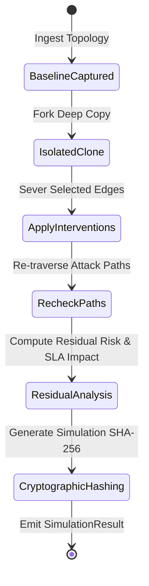

# SIMULATION METHODOLOGY SPECIFICATION
## SafeContain AI — Forensic Isolated Simulation Engine
**Document Version:** 1.0.0  

---

## 1. Principle of Isolated Snapshot Simulation

Under Non-Negotiable Principle #9 & #10:
> Every simulation must operate on an isolated graph copy or immutable simulation snapshot. Original infrastructure data must never be modified by simulation.

### 1.1 Snapshot Forking Protocol
1. **Source Version Capture:** Pre-intervention graph version, node count, edge count, and initial attack paths are computed.
2. **Deep-Clone Instantiation:** `engine.clone_isolated_snapshot()` performs a deep copy of the underlying `networkx.DiGraph` and node/edge dictionary stores.
3. **Intervention Application:** Candidate actions sever edges exclusively within the cloned instance. The baseline graph references remain untouched.
4. **Post-Simulation Graph Traversal:** Attack path discovery is re-executed on the snapshot to detect residual routes.
5. **Cryptographic Fingerprinting:** A deterministic SHA-256 hash is computed over the simulation inputs and results.

---

## 2. Simulation Lifecycle State Machine

