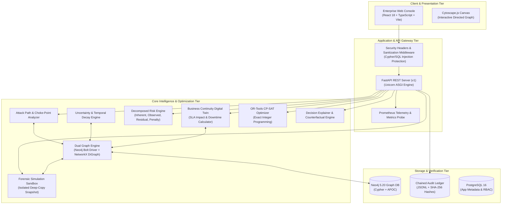

# SYSTEM ARCHITECTURE SPECIFICATION
## SafeContain AI — Enterprise Cybersecurity Platform
**Document Version:** 1.0.0  
**Status:** Approved Architecture  
**Target Environment:** Critical Infrastructure, Government, & Enterprise SOCs  

---

## 1. Architectural Principles & Quality Attributes

SafeContain AI is built upon five foundational architectural pillars:

1. **Uncertainty-Aware Epistemics:** Telemetry is rarely complete or uncontested. The platform treats evidence confidence as a first-class citizen using a 5-state epistemic model (`CONFIRMED`, `SUSPECTED`, `UNKNOWN`, `DISPUTED`, `STALE`).
2. **Business Continuity Digital Twin:** Defensive actions must be evaluated for their operational blast radius on critical workflows (citizen portals, payment processing, healthcare services).
3. **Rigorous Decision Optimization:** Containment planning is formulated as a formal optimization problem, solved via exact integer programming (Google OR-Tools CP-SAT) with verifiable constraint boundaries.
4. **Forensic Simulation Immutability:** Simulations execute on forensically isolated snapshots (deep copies). The production infrastructure topology is strictly immutable.
5. **Cryptographic Accountability:** Decisions, simulations, and approvals are bound to a forward-verifiable SHA-256 hash-chained ledger.

---

## 2. High-Level Component Topology

---

## 3. Communication Contracts & Protocols

| Interaction Path | Protocol / Transport | Data Format | Security Controls |
| :--- | :--- | :--- | :--- |
| **Web Console $\to$ API Gateway** | HTTPS / REST | JSON | TLS 1.3, Strict CORS, CSP, HSTS, `X-Content-Type-Options: nosniff` |
| **API Gateway $\to$ Neo4j Engine** | Bolt Protocol (`bolt://`) | Cypher Binary Protocol | Basic/Kerberos Auth, Connection Pooling, Cypher AST Sanitization |
| **API Gateway $\to$ In-Memory Engine** | Python In-Process Memory | Pydantic v2 Models | Type Validation, Memory Pointer Isolation |
| **API Gateway $\to$ PostgreSQL** | TCP / libpq | SQL / Parameterized Queries | SCRAM-SHA-256 Auth, TLS Encryption at Rest |
| **API Gateway $\to$ Audit Ledger** | Local Filesystem / Append-Only | JSONL with SHA-256 Hashes | Cryptographic Chaining, File Permission `0600` |

---

## 4. Subsystem Breakdown & Design Rationale

### 4.1 Dual-Engine Graph Infrastructure (`backend/app/graph`)
The system implements an adapter pattern unifying live Neo4j Cypher storage with an in-memory NetworkX directed multigraph. If a live Neo4j daemon is unreachable, the engine gracefully transitions to memory without dropping graph semantics, ensuring complete deployment resilience in air-gapped or lightweight testing environments.

### 4.2 Tri-Level Response Planner (`backend/app/optimization`)
- **Strategy 1 (Baseline):** Demonstrates unconstrained severity-first selection, picking highest-risk targets regardless of cost or workflow impact.
- **Strategy 2 (Greedy):** Computes marginal efficiency $\frac{\Delta R}{\text{Cost} + \lambda \cdot \text{Disruption}}$.
- **Strategy 3 (CP-SAT):** Formulates decision variables $x_i \in \{0, 1\}$ subject to hard budget ceilings and zero-downtime SLA constraints for critical citizen workflows.

### 4.3 Isolated Simulation Sandbox (`backend/app/simulation`)
To uphold Principle #9 (Simulation Immutability), the sandbox performs a deep-copy clone of the graph state. Interventions are applied only to the cloned snapshot. Post-containment path re-traversal uncovers residual vectors, producing an immutable, cryptographically hashed simulation summary.

### 4.4 Tamper-Evident Governance Ledger (`backend/app/audit`)
Every critical platform event generates a block:
$$\text{Hash}_i = \text{SHA256}(\text{EventID} \parallel \text{Timestamp} \parallel \text{Actor} \parallel \text{Action} \parallel \text{Resource} \parallel \text{Metadata} \parallel \text{Hash}_{i-1})$$
Any retroactive database or file modification alters subsequent block hashes, triggering immediate failure during automated integrity verification.
